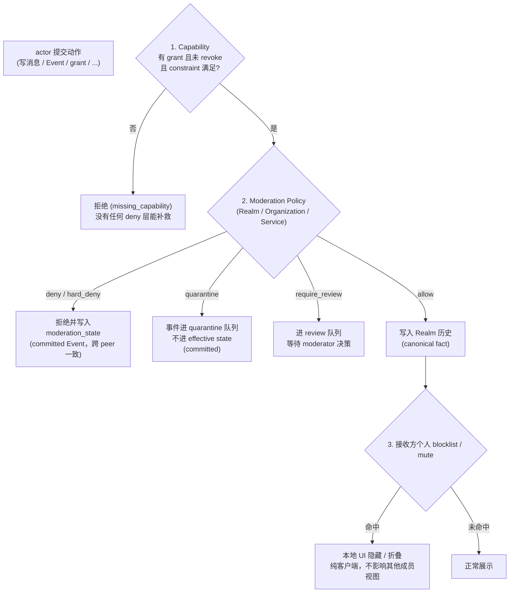

## 0. 规范语言

本文中的规范关键字（**MUST** / **SHOULD** / **MAY** 等）按 [conformance/normative-language.md](../conformance/normative-language.md) 解释；仅大写形式具规范约束力。

## 1. 目标

去中心化协作协议不能仅依赖"好人不会来捣乱"的假设。协议必须提供标准化的**内容审核与用户管理**机制，包括：

- 忽略/屏蔽其他用户
- Realm 级别的审核动作与可审计决策
- 组织级别的准入黑名单、允许列表和风险策略
- 服务器级别的访问控制

## 2. 设计原则

### 2.1 审核权由 Realm / Circle 管理员行使

去中心化环境中没有"全网管理员"。内容审核的权限由 Realm / Circle 的 Capability 体系决定：

- Realm-default 内容由持有对应 `ak.moderation.decision`、`ak.moderation.decision.lift`、`ak.message.redact` 或成员治理 grant 的 Actor 处理。
- Circle-scoped 内容由该 Circle 的管理员 / moderator 处理；Realm 管理员只有在 grant 明确覆盖目标 Circle 时才可以处理该 Circle 的治理事务。

### 2.2 屏蔽是本地行为

用户屏蔽另一个用户是纯本地的客户端行为，不需要广播到网络。协议不应强制"告诉全世界我屏蔽了谁"。

### 2.4 黑名单不是 capability grant

Arkret 的授权核心仍然是 allow-grant + explicit revoke。黑名单、过滤器和风险策略是额外的 deny/quarantine 层：

- 没有 capability 时，黑名单不能创建权限。
- 有 capability 时，Realm / Organization / Service policy MAY deny、quarantine 或 require review。
- 个人 block 只影响个人客户端体验，不能替 Realm 删除其他成员可见的事实。

### 2.5 Capability / Moderation / Personal Blocklist 三层判定

下图把动作从提交到呈现要穿过的三层 gate 画在一起。**Capability 是唯一的"能不能做"判定**，Moderation 只能在 capability 之上叠加 deny / quarantine / require_review，Personal Blocklist 完全是接收方本地行为。



读图要点：

- **Capability 是唯一 allow 来源**：黑名单 / moderation policy / personal blocklist 都不能凭空创造权限。
- **Moderation 决策 MUST committed**（见 §2.6）：`hard_deny` / `quarantine` / `require_review` 必须通过 committed Event 写入 `moderation_state` current state。
- **Personal Blocklist 不进 current state**：它只是接收方本地客户端 view 过滤，不广播、不共享、不替 Realm 删除其他人可见的事实。
- **Blocklist 的服务端不可枚举边界**：Station 与 federation peer MUST NOT 读取或解密个人 blocklist，也 MUST NOT 在提交、准入、Commit、投递或查询路径中按其命中分支、排队或人为延迟；提交 status、Problem type／reason、响应形状与 directory 结果不得因命中改变。持钥 holder 客户端在接收并验证后执行本地过滤，因此可不发送自动 read receipt、typing 或 presence；这些客户端信号的有无可能被对方观察，v1 不保证端到端不可推断。完整合同、自动回执限制与真实 transport 时序的验收边界见 [`client-preferences.md` §3.5／§3.5.1](../discovery/client-preferences.md)。

### 2.6 Moderation 决策 MUST committed

任何会改变其他 peer 对事件可见性、可写性或可分发性判断的 moderation decision——即 `hard_deny`、`quarantine`、`require_review`——MUST 通过 committed Event 写入 `moderation_state` current state。个人 blocklist 仍是 out-of-band，不进入该 current state。

**提交路径（normative）**：`ak.moderation.decision` 以 Event ID 作为稳定 decision identity；`ak.moderation.decision.lift` 的 payload 必须携带该 `decision_ref` 与目标 moderation result 的 `expected_revision`。裁决一律经 `POST /_arkret/self/events` 作为 self-authored Event 提交，不经实现私有运维写路径。治理 Station在同一 commit 事务中检查 decision 当前仍 active、target 一致且 revision 精确匹配；stale lift 拒绝。lift 只解除被指名 decision 的后续治理效力，不删除审计事实，也不复原已经接受的 redaction、已经密码学销毁的 content key 或其它不可逆 effect。

**active decision set 与 effective decision（normative）**：moderation_state current value 是按 target 索引的 active decision records。对 read/write/distribute，reducer 先筛选适用 records，再按 `hard_deny > quarantine > require_review > none` 取最严格结果。多个 issuer 的 records 可以同时 active，顺序只来自该 stream 的 RealmCommit，不按本地到达时间选择。

**`require_review` 承载与解除（normative）**：active `decision="require_review"` add 本身就是 pending-review 的 canonical 承载；review queue 从这些 active adds 派生，不另造第三套中间态。候选 Event / operation 在 review 期间保持 proposal / observed-only，不得进入 effective state。reviewer 必须用以下封闭路径结束该 gate：

- **allow**：在同一 ordered submit batch / control transaction 中，对本次 gate 的全部 active `require_review` decision 分别提交 `ak.moderation.decision.lift`。lift 后若不再有更严格 active decision，候选仍 MUST 以**当前** capability、policy、membership、quota 与 target state 重新求值后才可接受；不得把旧 review 结果当作绕过当前授权的 allow grant。
- **quarantine / hard deny**：在同一 batch 中 lift 本次 gate 的全部 active `require_review` decision，并 add 一条 replacement `ak.moderation.decision`（`quarantine` 或 `hard_deny`）。lift 与 replacement 必须原子接受；缺一时保持原 pending 状态并拒绝部分提交。
- 对同一 target 仍有其它适用 active decision 时，effective decision 继续按上述最严格 fold 计算；解除一条 review 不得隐式 lift 其它 issuer 的 decision。

**lift 与替换（normative）**：lift 只能改变 `decision_ref` 指定的一条 record；不得隐式解除同 target 的其它 issuer decision。若要替换处置，提交方可在同一 ordered batch 中 lift 旧 decision 并新增 replacement decision；两者必须原子提交，并分别通过当前 capability 与 revision 检查。

## 4. 用户屏蔽 (Ignore/Block)

### 4.1 屏蔽是 Actor-Private 状态

用户可以屏蔽任意精确发送者 ActorId，屏蔽列表存储在本地或用户的私有 account data 中。
account-data key `ak.account.blocklist` 的**唯一权威结构定义与受检示例**在
[`../discovery/client-preferences.md` §3.5](../discovery/client-preferences.md)；本节不复制 payload，避免
重复 holder 坐标、裸 DID 或 target union 再次形成第二套结构。

### 4.2 屏蔽行为

客户端在渲染时：

- SHOULD 隐藏被屏蔽用户的消息
- SHOULD NOT 显示被屏蔽用户的 Typing 和 Presence 状态
- SHOULD NOT 为被屏蔽用户的消息生成通知
- SHOULD 默认拒绝被屏蔽用户发起的 DM、call invite、contact request 和 applet-mediated request
- MAY 在共同 Realm 中显示折叠占位符，避免破坏上下文
- MUST NOT 从网络层面丢弃被屏蔽用户的 Operation（这些 Operation 对其他成员仍然有效）

加入、移除、CAS revision、共享 Realm 与 Direct Conversation 的收取边界、解除屏蔽后的历史重算及 block / mute / hide 的精确差异，以 [`../discovery/client-preferences.md` §3.5–§3.5.1](../discovery/client-preferences.md) 为唯一权威源。本节不得另定义第二套屏蔽状态机。

### 4.3 个人过滤对象

个人 blocklist MAY 包含：

- 完整发送者 ActorId（外层统一为 `target.kind="actor"`；内部允许 account 或 service ActorId）
- device verification-method DID URL / `device_id`（设备自身没有 DID）
- handle
- domain
- Applet id
- keyword / mention pattern

actor target 只按 Event / request 已验证的完整发送者 ActorId 精确匹配，不得按 Organization、Realm、
托管 Station、转发 service 或其它 affiliation 扩张。`handle` 只与发送者已验证 handle claim 的
canonical handle 匹配；`domain` 只与该 claim 的 domain 分量或已验证 DID 域名绑定匹配；display name、
未验证身份字符串或裸后缀不得命中。`keyword` 才是纯内容字符串过滤。三者都只在 holder-private
projection 生效，不证明任何 Actor、service、Organization 或 Realm 归属，也不得改写身份或共享治理事实。
v1 不定义 `organization` 或 `realm` personal-blocklist target。

### 4.4 隐私要求

个人 blocklist 是 holder-private account data。v1 实现 MUST NOT 把明文 blocklist 上传给 Station、通知服务、Realm、Directory、federation peer 或被屏蔽方。

跨设备同步 MUST 使用加密 account data。Station / federation peer 只能看到不透明密文；v1 没有
向 confidential service 交付个人 blocklist 明文及读取授权的正式操作。只有持钥 holder 客户端执行
个人过滤，且不得向发送方或 peer 暴露命中结果。

## 5. Realm 审核工具

### 5.1 内容删除

管理员可以通过 `ak.message.redact` 操作撤回任意成员的消息：
- 需要 `ak.message.redact` capability（撤回他人消息的非 `.own` 形态；moderator 身份本身**不**隐含该撤回权，审核员 bundle 必须在 grant 的 `actions[]` 中显式列出 `ak.message.redact`）
- 撤回会产生 tombstone，不可逆
- 审计视图中仍可看到撤回记录

### 5.2 用户封禁

管理员通过 `ak.member.state{membership="ban"}` Event 封禁用户（成员状态机详见 [`../models/realm-and-space.md` §2.7](../models/realm-and-space.md)，policy 对象详见 [`../models/governance-objects.md` §3](../models/governance-objects.md)）。封禁后：

- 被封禁用户无法重新加入该 Realm
- 其未来的 Operation 提交将被 Station sync surface 拒绝
- 是否对其隐藏**已可见**历史内容由 Realm Policy 决定；ban 后的 stream backfill 与新 MLS epoch delivery MUST fail closed。其真相源为 [`history-visibility.md` §6](./history-visibility.md) 与 [`../crypto-media/device-lifecycle.md` §12](../crypto-media/device-lifecycle.md)：接收 principal / device 已处于 ban / leave / removed 时不得获得新的 committed Event 或 Welcome delivery。Realm policy 只能在此基础上**更严**。

### 5.3 Realm 内审核状态边界

v1 不定义可复制的 Realm 级 blocklist、server ACL 或 content-filter policy Event。Realm 内持久化治理动作由既有原语直接表达：成员封禁使用 `ak.member.state{membership=ban}`，内容撤回使用 `ak.message.redact`，隔离、复核及其解除使用 committed `ak.moderation.decision` / `ak.moderation.decision.lift`。

服务端 MAY 配置部署本地的风险信号、过滤器与 ACL，但这些配置不是 Realm 共享状态，不得伪装成标准 Event，也不得赋予 capability。Organization 明确适用于某 Realm 的 `ak.organization.moderation_policy` 可作为额外 deny 层；Realm 不存在独立 override current state。
## 6. 服务器级访问控制

### 6.1 本地部署 ACL 与 Realm ACL 的边界

Station 可以配置本地服务器级 ACL，控制哪些 peer 的联邦请求被接受、拒绝或停止 fanout：

```json fragment
{
  "server_acl": {
    "allow": ["*"],
    "deny": [
      "spam-node.example.com",
      "*.malicious.example.net"
    ]
  }
}
```
该 `server_acl` 是部署本地 policy 名称，不是标准 Event kind，不进入 `event-kind-registry.json`，也不是可复制的 Realm 状态。实现 MUST NOT 接受 `ak.realm.server_acl`、`ak.server.acl` 或等价未注册 kind 作为 Realm 权威状态。

规则评估顺序：先检查 `deny` 列表，再检查 `allow` 列表。支持 glob 通配符时，通配符只允许覆盖完整 DNS label；`*.example.com` 不得匹配 `example.com` 或 `badexample.com`。推荐实现同时支持 exact `service_id`、`trust_domain` 与 DNS domain 规则，并优先使用已验证 service DID。

### 6.2 Realm 级 peer 限制

v1 不提供可复制的 Realm 级 server ACL。接收方以 §6.1 的部署本地 ACL 拒绝 peer；由 Organization 治理的部署还可应用明确覆盖目标 Realm / service 的 `ak.organization.moderation_policy`。两者都是 capability 之后的 deny 层，不得授予权限，也不得静默改写已接受历史。

需要跨独立 peer 协调 Realm 级 ACL 时，必须另行定义完整扩展（包括 Event kind、合并语义、授权、SDK 与 conformance），不得提交未注册的 `ak.realm.server_acl`、`ak.server.acl` 或其他临时 Realm policy Event。
### 6.3 与联邦协议的关系

Server ACL 在联邦层（参见 [`../sync/federation.md`](../sync/federation.md) §3.4）起作用。当 Station 收到来自被 deny 的 peer 的 `ak.peer.events.command.submit.v1`（`/_arkret/peer/events`，`Source-Service-ID`、source trust domain 或已验证 endpoint domain 命中 deny list）请求时，MUST fail closed，SHOULD 返回 `403 policy_denied` 或 `403 capability_denied`，并保持错误最小披露。

整机级 defederation 需要入站与出站同时配置：拒收该 peer 的 push / pull / checkpoint probe，并停止向其 fanout 新 Event、push、to-device、key-package、backfill 和媒体 / snapshot fetch。

## 7. 组织级审核策略

Organization MAY 为其控制或背书的 Realm 与服务发布组织级审核策略。该策略仅通过显式引用生效，不会隐式继承、自动级联或作为全局默认策略适用。

每个 `organization_id` 仅有一个由 Organization DID 当前认证治理状态指定的 policy authority Realm；仅该 Realm 的已接受 `ak.organization.moderation_policy` Event 可以更新全局 `(organization_id)` current state。`ak.realm.organization` 关系只决定适用范围，不授予普通 Realm 写权威。接纳方 MUST 验证认证绑定、Event 外层 `realm_id`、covering RealmCommit 与当前绑定相同，并在同一治理事务中校验 source revision；跨 Realm 复制或读取方 MUST 验证同一 source Commit 和未被取代的绑定，不能按到达顺序选 winner。v1 当前没有可认证的唯一绑定及跨 Realm current 读取载体，因此该 Event 的生产接纳和依赖它的跨 Realm join/federation deny 读取 MUST fail closed 且零写入，不得从本地配置、发现投影、关系、PCR 密文或首个到达的 Event 推断权威。转移协议落规前不得变更 authority Realm；本段不引入新的转移入口。

该策略由 `ak.organization.moderation_policy` Event 承载。它的 payload 是
[`event-payload.schema.json#/$defs/organization_moderation_policy_state_payload`](../../artifacts/schemas/event-payload.schema.json)：
`organization_id: did_core_id`（即唯一 current state subject）加上
whole-value `value`；策略内容全部位于 `value` 内，**不得**平铺到 payload 顶层——该 schema 是
`additionalProperties:false`，平铺形态会被直接拒绝。`value` 是 required，且 v1 只有
`organization_moderation_policy_document` 这一 closed family：不存在 `value.schema` selector、外部 schema
分派或 subject-only no-op/tombstone；未知 value 字段同样以 `schema_violation` 拒绝。Event 本身已由 Organization 治理密钥签名并进入
accepted RealmCommit state，因此 payload **不携带**独立的 detached `proof`：再签一次覆盖的是同一批 canonical
bytes，只会多出一条可漂移的第二真相源。

```json fragment
{
  "kind": "ak.organization.moderation_policy",
  "payload": {
    "organization_id": "ak:did_core:webvh:zGUwpRSnyVCLzU7upsm9iSwEv",
    "value": {
      "policy_id": "ak:policy:0198f1a2-4c3d-7e56-8a90-1b2c3d4e5f60",
      "policy_scope": {
        "realm_ids": ["ak:realm:AcNT448P7qPaGrcUoLXxUyutbNGE4ZXv8UN835EnK4Wp"],
        "service_ids": [
          "ak:did_core:webvh:z5a3yeFnKQFn6ZqPY1Qgv3RrZ",
          "ak:did_core:webvh:z9hEFwrg1A6sjcDxhuzWJGKhe"
        ],
        "applies_to_owned_realms": true
      },
      "rules": [
        {
          "target": {
            "kind": "organization",
            "organization_id": "ak:did_core:webvh:z6zPnbtvkN7vxa9zUyCgGyX52"
          },
          "action": "deny_federation",
          "reason_code": "abuse_network"
        },
        {
          "target": {
            "kind": "claim_selector",
            "claim_kind": "organization_membership",
            "issuer_id": "ak:did_core:webvh:zCJLLNnZDTQJWQp7tztodmPUc"
          },
          "action": "deny_restricted_join"
        }
      ],
      "not_before": "2026-04-26T00:00:00.000Z"
    }
  }
}
```
规则：

- 组织策略只对显式引用它的 Realm / 服务有权威；对官方 Realm 也仅当其 `ak.realm.organization` 背书声明组织策略适用时才生效。
- v1 不定义 Realm 级 override；组织策略是否适用完全由已接受的 Organization / Realm 关联与 `policy_scope` 决定。
- 组织级 deny SHOULD 由 Station ACL、Directory 过滤与直接治理 Event 共同执行。
- 组织策略 MUST 由 Organization DID 或受授权的 governance service DID 签名。
- 组织策略 MUST NOT 暴露用户私有 blocklist、私有 handle 或未披露的组织成员关系。

## 8. 运行时 moderation 求值

Organization 审核策略与部署本地审核配置由接收请求的服务根据 accepted policy state 在本地求值，可覆盖以下场景：

- invite / join request
- knock request
- message create / edit
- media upload
- Applet transaction
- federation transaction
- directory listing
- call invite

运行时求值 MAY 得到 `hard_deny`、`quarantine`、`require_review` 或 `soft_deny`，但 policy MUST NOT 自行授予 capability。

### 8.1 Runtime decision

运行时判定结果为 `allow`、`soft_deny`、`hard_deny`、`quarantine` 或 `require_review`。Organization policy 的 `deny_*` 规则按被拒动作映射为 `hard_deny`；`quarantine_message` 与 `require_review` 分别映射为同名运行时结果。部署本地过滤器 MAY 产生更严格的结果，但不得把本地结果写成不存在的 Realm policy 状态。
## 9. 服务端威胁借鉴

服务端抗滥用经验（入口源身份强制、多级限速、批量事件反滥用、最小可观察性差异、可疑媒体隔离、
可追溯审计）的单点承载是 [`../security/server-threat-model.md` §2.3](../security/server-threat-model.md)；
其在授权与联邦层的 normative enforcement 分别见 [`../authz/capabilities.md`](../authz/capabilities.md)
与 [`../sync/federation.md`](../sync/federation.md)。

## 10. v1 流程要求

- 自动化审核只能产生 risk signal、`quarantine` 或 `require_review` 建议；除非 Realm policy 明确授权，AI 分类器不得直接 hard delete、ban 或扩大可见性。
- 跨 Realm 共享封禁列表必须由 Organization DID、联盟治理 DID 或受信 issuer 签名，并声明 scope、reason code、evidence hash 和过期时间。默认不得把个人 blocklist 发布为共享封禁。
- 审核操作 MUST 使用不可抵赖日志：moderator DID、device/service proof、policy version、target event hash、action、reason code 和 audit timestamp 都必须进入签名记录。
